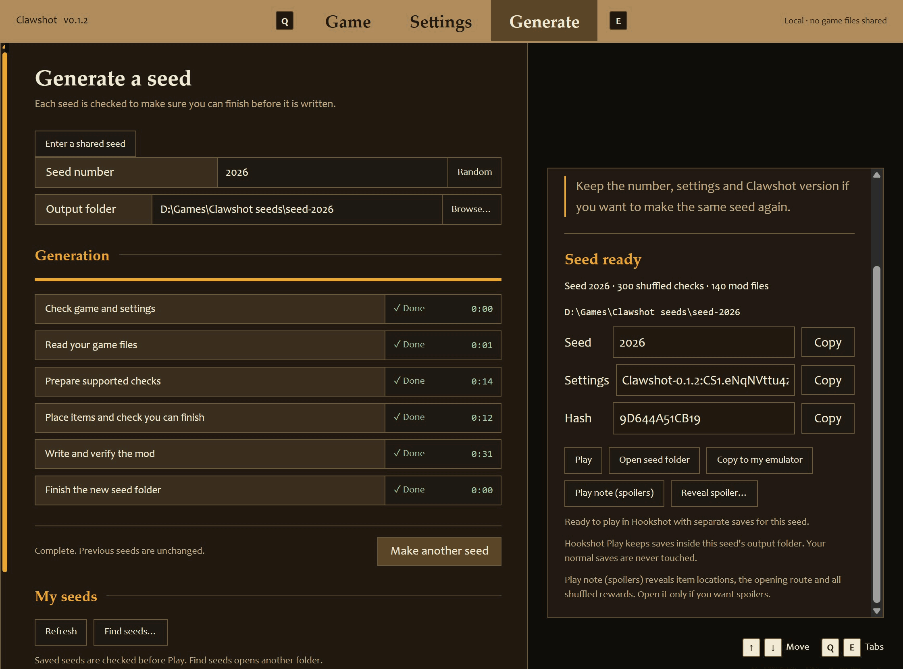
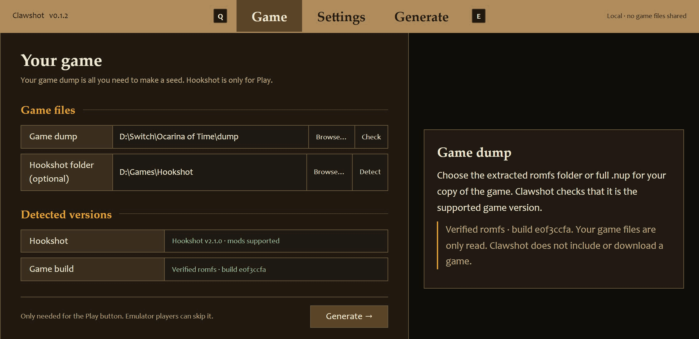
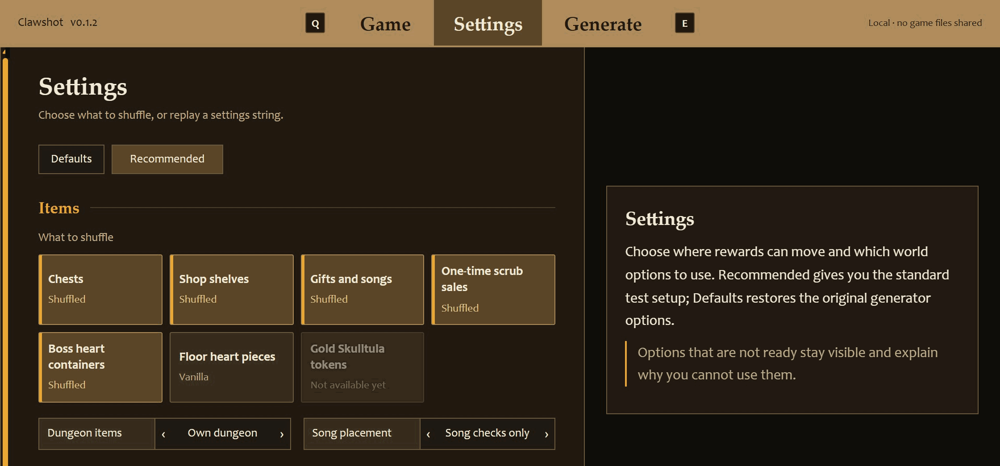
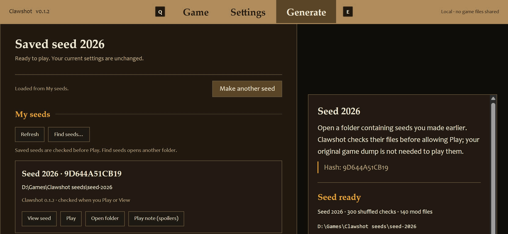

# Clawshot

[](https://discord.gg/7R5ZXPcJqn) [](https://github.com/hiKareeem/Clawshot/releases/latest)

An unofficial item randomizer for *The Legend of Zelda: Ocarina of Time* on Nintendo Switch 2,
inspired by OoT Randomizer and Ship of Harkinian's randomizer.



> [!IMPORTANT]
> Clawshot reads **your own game dump**, moves items according to access rules, and writes a
> RomFS mod: a folder of changed game files loaded instead of the originals. The supported game is
> program `0400486024DEC000`, Version 1.1.1 (update v131072), build `e0f3ccfa`.

> [!NOTE]
> This project is AI-assisted: the code is written with AI coding tools, directed, reviewed and
> play-tested by its maintainers. It contains no AI-generated art or audio.

**This is not the game.** This repository contains code, logic and location definitions, not game
files, keys or generated mods. You must generate the mod locally from your own dump. Never share
that output. Clawshot is not affiliated with or endorsed by Nintendo.

## Get started with the UI

1. Download **Clawshot-\<version\>.zip** from a [UI test release](https://github.com/hiKareeem/Clawshot/releases),
   not GitHub's generic source-code zip. Unzip the whole folder outside your game, Hookshot and Longshot folders.
2. **Windows:** double-click **Clawshot.bat**. **Linux:** run **clawshot.sh**.
   **macOS (untested):** right-click **Clawshot.command** and choose **Open** the first time
   because the download is unsigned; later, double-click it.
   The first start may download the checked app-local uv tool, Python and locked dependencies; no administrator access.
3. On **Game**, Browse to your own supported **romfs folder, .nup or .nx** and Check it.
   Hookshot or Longshot is optional: one of them is only needed for the Play button.
4. Go to **Generate**. Recommended settings, a random seed and a new Documents folder are ready;
   leave them alone for a first seed, then choose **Generate seed**. Wait for **Seed ready**.
   **Play note (spoilers)** is optional: it reveals item locations and all shuffled rewards; it does not open automatically.
5. **Hookshot or Longshot:** on Game, choose its game folder (or your Longshot Launcher folder) and press
   **Detect**, quit any running Hookshot or Longshot, then press **Play** and start a new game.
   This seed has its own playthrough. Only when Play creates its save folder does it copy `option.sav` and
   `account.sav` from the newest save-ID folder of the chosen game's own user folder (a Longshot Launcher's shared
   one), plus Longshot's `longshot_options.ini`, keeping options such as Invert Jump; it never overwrites the seed's
   files and copies no progress slots.
   **Emulator instead:** back up your normal saves, then **Copy to my emulator**, choose this game's
   mod folder and enable only that seed. Existing copies are never replaced.

**Longshot** is the continuation of Hookshot, where its top maintainers moved (Longshot README, introduction);
Hookshot's GitHub repository has been offline since 2026-11-13. Get Longshot's launcher from
**<https://longshot.magicbean.dev/download>** (project: <https://git.magicbean.dev/MagicBeanDev/Longshot>); it builds
the game on your PC from your own dump. Kareem verified app Play on **Longshot v3.0.0-rc.2**
on 2026-11-13: the seed loaded with isolated saves, game options carried over, shuffled rewards matched,
Xbox prompts displayed correctly, and progress survived reload. His later in-game checks ran on **Longshot 3.0.0**.
On **Longshot 3.2.0**, focused story-scene checks passed on 2026-11-25: the moat and Saria gave one Heart Piece
and healed, and Talon's shuffled first prize worked without the milk prop or bottle wording. Not every runtime/item
combination is played.

Keep the terminal open. **My seeds** finds your earlier seeds after a restart. Copy the number,
settings and short hash to share a seed recipe, never the generated game files. **On Discord, use
Copy for Discord** or put the settings string inside single backticks (`` `Clawshot-…` ``): Discord
otherwise reads text between two `_` as italics and drops them, and the string stops working.
[The UI guide](docs/ui.md) covers loading, saves, shared seeds and troubleshooting.
Keyboard/mouse only: **gamepad and Steam Deck controller input are not done**.
The [Tracker tab](docs/tracker.md) reads saved inventory and per-dungeon keys, with a compact OBS view.
It also highlights the open checks that are in logic for what your save holds, for seeds made by the same
Clawshot version, and lets you mark checks the save cannot show (shop items, a few gifts) as done; the OBS view
shows neither. It reads many gifts from the game's own records: ten of them read as collected after Kareem got
them in game. The maintainers' in-game check of in-logic and marks is still pending
([design record](plans/tracker-in-logic.md)).

<table>
  <tr>
    <td width="33%" valign="top"><br><sub><b>Game:</b> your dump checked as the supported build; Hookshot or Longshot is optional.</sub></td>
    <td width="33%" valign="top"><br><sub><b>Settings:</b> choose what to shuffle, or replay a settings string.</sub></td>
    <td width="33%" valign="top"><br><sub><b>My seeds:</b> earlier seeds, ready to view or play again.</sub></td>
  </tr>
</table>

## At a glance

- **Shuffled now:** chests, shop shelves, NPC gifts and songs, one-time Deku Scrub sales.
- **Optional:** boss Heart Containers, floor Heart Pieces, Gold Skulltulas (requires chests),
  and small keys outside their own dungeon (opt-in **Small keys anywhere**, including the Well floor key).
  Shadow's floor key stays unchanged. **Fortress jail keys** are a separate experimental, default-off option;
  one rescue and its once-only replacement passed on rc.7; on Longshot 3.0.0 (2026-11-21) four keys from four chests,
  all four rescues, the card once and Training Ground entry also passed.
  Experimental **All dungeon items anywhere** also releases maps, compasses and boss keys.
- **Experimental, default off:** dungeon rewards shuffled among their nine usual rewards (Rauru included), and a stones/medallions/rewards-count bridge. First-pull reward delivery and the medallion-count bridge passed in game; this is not a full shuffled playthrough.
- **Experimental:** a Gold Skulltula token-count bridge (`--bridge tokens --bridge-count N`,
  0–100, including chest tokens), and 0–6 Ganon trials remaining (`--trials-count N`, default6).
  Partial trial seeds name the remaining trials in the spoiler, play note and first barrier-view dialogue.
  On Longshot 3.0.0 (2026-11-21) a 16-token bridge stayed shut at 15, opened at 16 and persisted after
  Save/Continue; zero trials' barrier and tower lift passed on an adjusted save copy, not a fresh new game.
  Counts 1 and 2 passed on Longshot 3.0.0 (2026-11-23): count 1 end to end, from a new game and then a castle save
  adjusted to one remaining trial; count 2 for its first trial. Counts 3–5 are built, not played
  ([trials play record](plans/rounds/r20-trials.md), [count 1 and 2 checks](plans/rounds/r21-checks.md)).
- **Not shuffled yet:** cows, pots, crates and loose rupees.
- **Excluded locations:** pick checks by area/search in Settings, or use `--exclude-locations` with exact
  world check names. They never hold progression; impossible lists are refused. [Reference](docs/settings.md#excluded-locations).

Choose the kinds you want. The UI starts with Recommended; the generator's Defaults shuffle chests
only. Some checks stay unchanged pending in-game tests; the evidence and limits are below.

## Status

**Public test builds, not a finished randomizer.** Seeds are being played and the remake's access
rules are still being checked. Every generated seed must pass the logic search before it is written;
that proves the model, not that every route has been verified in the game.

| Feature | Current evidence and limits |
|---|---|
| Chests | Changed chest rewards work in game. 178 of 184 ordinary chests are shuffled; duplicate/failure copies and repeat rewards stay unchanged. Includes the played Field/Lake routes, four-torch Lake grotto, Valley grottos, Fortress underground, Fountain scarecrow and Well hidden-hole routes; the Well conservatively requires the Lens. |
| Shops | Shuffled native shop items and purchases work in game. Arbitrary major items cannot use a stand-in shelf display. |
| NPC gifts and songs | Gift swaps and Great Fairy once-only rewards work in game, as does the Kokiri shopkeeper's extended gift window. All seven frog checks have passed their in-game experiment. The adult Rolling Goron's and King Zora's tunic gifts are shuffled too; each gave its shuffled item once in game. Not every gift or item combination has been played. |
| One-time Business Scrubs | Four kinds of one-time Deku Scrub sale are enabled; repeat vendors stay unchanged. The adult Mirror Shield purchase that previously froze now finishes. Not every shuffled sale or item/age combination has been played. |
| Boss hearts and floor Heart Pieces | Optional, off by default. The five native floor pickups, Ocarina of Time and, with songs anywhere, the twelve songs are admitted. Fairy Ocarina stays at BossHeart (Gohma PASS) but is excluded from Freestanding after the empty child-roof failure. Other source/reward pairs remain subject to the [integration play record](plans/rounds/r22-pr42-integration.md). |
| Gold Skulltulas | Optional, off in both presets; requires Chest shuffle. All 100 native sources are admitted, each with its structural check. Generated donors add Fairy Ocarina and songs with songs anywhere; ten songs are accepted by analogy, not individually played. All non-token rewards spin. Other [destination restrictions](docs/settings.md#what-enters-the-shuffle) remain. |
| 100-token House reward | Separate experimental, default-off option; requires Gift shuffle. Allows progression at the first reward without changing the native repeating payout. [Settings and played evidence](docs/settings.md#what-enters-the-shuffle). |
| Hints and convenience options | Gossip Stones speak hints without the Mask of Truth by default; this, fast start, the forest option that opens only the exit bridge (`--forest closed_deku`) and 10-rupee Kokiri prices have in-game evidence. |
| Scene handoffs | Lessons use a normal get only with zero stock of both ocarinas; either instrument retains the native lesson, at either age. Saria's separate farewell skip remains experimental and off by default. [Settings and played evidence](docs/settings.md#scene-handoffs-experimental). |
| Free time travel | Experimental, off by default. Early adult return, the Prelude scene and the corrected first adult arrival have passed in-game checks. |
| Starting inventory | Experimental, empty/off by default: chosen native items, songs, extra hearts, full wallet and maps/compasses for New Game only. Starting copies leave the pool as junk; unsafe choices are refused. One broad New Game start passed on Longshot 3.0.0 (2026-11-21): its items, songs, 6 hearts and 500 rupees worked, Impa's and the Windmill's lessons still played, the Ocarina of Time stayed equipped, and the Master Sword pull and pause maps worked. Other choices are not individually played. [Settings](docs/settings.md#starting-inventory-experimental). |
| Master Sword shuffle | Experimental, default off; requires Chest shuffle and free time travel. The sword goes to a chest; the pedestal still changes age. [Settings and played evidence](docs/settings.md#master-sword-shuffle). |

With Gift and Token shuffle (Token is off in both presets), played bottle, Double Defense, Echo Gem and gold-rupee
rewards may also reach Skulltulas. With Gift shuffle, eight gift items may also be found in chests: Light Arrows,
Nayru's Love, Farore's Wind, the Echo Gem, Double Defense, Biggoron's Sword, an empty Bottle and Rupees (200).
Kareem checked each one's model, text and use from a chest on Longshot 3.2.0 (2026-11-25); they still never go
to Scrubs. Fixed Deku Stick (20) and Nut (30) capacity upgrades may go to Scrubs, chests and, with Token shuffle,
Skulltulas: both were played from chests, and both from Skulltulas (the Nut upgrade earlier, on Longshot rc.3).

**Confirmed with Gift shuffle:** the first two Bombchu Bowling wins and both normal
shooting-gallery prizes give the seed's rewards (`R10-MINIGAMES-CHILD-JABU`,
`R10-MINIGAMES-ADULT`). Later wins give the game's usual rupees. Expert galleries stay unshuffled:
their native rewards are repeatable wallet rupees (Market 30, Kakariko 70), not unique first prizes.

**In every seed, the Lost Woods ocarina memory game's first won round gives its prize once**, whether
shuffled or the vanilla Heart Piece; later sessions retain native payouts. The separate **Bag bombs without the
Bracelet** option is experimental and off by default; it keeps the Bomb Bag requirement and leaves Bomb Flowers
unchanged. Kareem played both on Longshot 3.2.0 (2026-11-25), including after a reload
([recent checks](#recent-in-game-checks), [play record](plans/rounds/r22-games.md)).

**New with Gift shuffle:** the child Market Potion Shop bottle tutorial and Dampé's graveyard
digging prize now give shuffled rewards. Both passed their in-game checks on 2026-11-10
(`R10-MARKET-BOTTLE-FIX`, `R10-DIGGING`). The shop's corrected swap passed re-entry and shopping;
Dampé still shows a heart prize but gives the shuffled item.

With **Gift** on, **Medigoron, Granny and the Wasteland carpet seller** each sell one shuffled
item once at their normal price, then return to normal sales. Granny refills an existing empty
bottle with Blue Potion for 100 rupees; the carpet seller sells Bombchus; Medigoron sells a
replacement Knife only after it breaks. Granny's Blue Potion is replaced by **Rupees (5)** in
the shuffled pool. Medigoron needs no wallet upgrade. Reach the carpet seller from the Fortress
side with Hover Boots or Longshot, or the existing opt-in Wasteland crossing trick.
Kareem passed the purchases, saved returns and repeat sales on Longshot 3.2.0 (2026-11-27);
the intact-Knife “come back if it breaks” line is not another purchase offer.
[Merchant prices and requirements](docs/settings.md#gifts-enabled-versus-held).

Expert galleries and some Skulltula House rewards stay unchanged.
The 10- and 40-token reward swaps have been observed; the separate 100-token opt-in also passed
([100-token reward checks](plans/rounds/r19-tokens.md)). This does not certify every threshold or replacement.
The Door of Time's earlier song-only and open modes passed a first door/sword-pull check.
Both wait for Field-arrival clock state and Zelda/Impa's real send-off. The open-mode gate and
later escape/moat order repair and immediate child-return clock clear passed on Longshot rc.7.
Kareem reports the Hyrule Field day/night clock working as expected in his seeds since then (2026-11-21); the
first-arrival lighting repair has no separate staged v5 check. For new seeds; no save-repair or older-seed compatibility guarantee.

Cows remain **research only; nothing shipped** ([cow research](plans/rounds/r19-cows.md)).
Cows, pots, crates and loose rupees are not shuffled. Dungeon reward shuffle is a separate experimental option, off by default; it does not move rewards outside their nine slots.
With reward shuffle on, the closed Door opened with all three Stones owned while Dodongo and Jabu were
unfinished, stayed open, and triggered no escape/moat scene. With only Emerald and Ruby owned, the Door
stayed closed and no opening scene played.
The Light Arrows scene (LACS) and vanilla-bridge logic follow the Shadow/Spirit awakening story,
not owned medallions. This correction is **static event-data evidence only, not played**
([Light Arrows scene research](plans/rounds/r19-lacs.md)).
**Small keys anywhere** puts dungeon chest keys and the Well floor key in supported shuffled chests,
including other dungeons and the overworld. The Well replacement keeps a key-shaped model; leaving it,
recovering it, collecting it once, returning and Continue passed in game. Shadow's floor key always stays in
its usual place, under every setting ([floor-key record](plans/rounds/r19-keys.md)).
**Fortress jail keys** is a separate experimental, default-off switch. After answering Yes to the carpenter
boss, one guard encounter, rescue and 20-rupee drop passed; the drop stayed collected after returning and Continue.
On Longshot 3.0.0 (2026-11-21) the option also passed four keys from four chests, the guards' 20-rupee drops,
all four rescues, the captain's card once and Training Ground entry with its 30-rupee fee
([Fortress play record](plans/rounds/r20-cows.md)). That is not a full playthrough; it stays experimental.
Experimental **All dungeon items anywhere** also releases maps, compasses and boss keys, including
Ganon's Castle's boss key. Map/compass display and a remote boss key opening its door have passed in game.
Defaults and both presets keep every dungeon item home.
A dungeon item found outside its dungeon names that dungeon in its pickup messages
(English in every language); the game's key counters still show only the dungeon you are in. The
played gates cover key chests in and out of dungeons, correct credit, door spending and reloads,
plus presentation on a whole generated anywhere seed. Not every combination or a full
playthrough has been played.
All eight upgrade chains—Hookshot, strength, scale, wallet, bomb bag, quiver,
slingshot bag and magic—are always progressive. Copies are chest-only; the get-item
name/text and grant follow the selected tier, while the rising model stays the base.
On Longshot rc.2 (2026-11-13), Kareem passed Mido's Hookshot→Longshot and Silver→Golden Scale chests, then a
separate-chest retest of every remaining top tier ([progressive-chest record](plans/rounds/r14-progressive.md));
not every collection order or pickup combination has been played.
Entrance shuffle and Archipelago are not supported.
See [settings and restrictions](https://github.com/hiKareeem/Clawshot/blob/main/docs/settings.md) for the detailed reference.
Evidence: [the roadmap index](https://github.com/hiKareeem/Clawshot/blob/main/plans/00-roadmap.md)
plus the linked play records, and [playtest answers](https://github.com/hiKareeem/Clawshot/blob/main/plans/playtest/answers.md).

### Recent in-game checks

Kareem reported these played checks:

**Longshot rc.7 (2026-11-19):**

- **New seeds fix the free child sword on returning from adult.** Kareem passed the return check on Longshot rc.7.
- **Mirror Shield scrub purchase (#33):** the adult purchase finishes instead of leaving Link in the get-item pose.
- **40-token reward (#11):** the shuffled reward check passed; not every House threshold was played.
- **Dungeon map/compass display:** the display check passed, not every source/target combination.
- **Well floor key:** leaving it, recovering it and collecting it once passed; it stayed collected after
  leaving/returning and Continue. Shadow's floor key stays vanilla.
- **Reward shuffle's first pull:** the first sword pull gives the shuffled reward.
- **Medallion-count bridge:** stays shut below the configured count and opens at the count.
- **Owned-Stones Door:** opens with all three Stones while Dodongo/Jabu are unfinished, stays open,
  and triggers no escape/moat scene.
- **Taking the Fairy Ocarina after the Ocarina of Time keeps Time selected in new seeds.** Child and adult checks
  passed, including adult Sun's Song and Continue. Adult Sun's Song also worked with Fairy in the control;
  that does not establish every adult song. The separate lesson-handoff checks are recorded below.
- **Mido still checks sword and shield after an early Zelda visit.** The repaired passage and Deku Tree mouth
  stayed open after reloading in Kareem's check.
- **Dampé will not start a race without Hookshot or Longshot.** The no-Hookshot check faded back in front of
  Dampé, with normal movement and the existing warp back up usable; it did not return Link to the surface.
  Newer seeds do return him to the surface (Longshot 3.2.0, below).
- **Castle owl:** no speech, with a short fly-away retained. Owl skips remain experimental.

**Longshot 3.0.0 stable (2026-11-19/20):**

- **Two-Stone Door refusal:** with Emerald and Ruby owned, the Door stays closed and no opening scene
  plays; the saved state confirms both Stones and the closed Door.
- **Field owls near Kakariko and the Lake approach:** no speech, with a short look-and-fly-away.
- **Summit and Lake travel owls:** a short offer and working flights. These owl skips remain experimental.

**Longshot 3.0.0 stable (2026-11-20):**

- **Morning scene skips:** Minuet gave Boomerang without a lesson; Impa skipped the lesson,
  gave Boomerang and kept the normal Hyrule Field dialogue. Saria gave the correct item text, then
  went straight to Hyrule Field without the farewell movie with `skip_saria_farewell` on.
  Her brief pop-in is cosmetic ([scenes played results](plans/rounds/r19-scenes.md#played-results-and-stock-only-correction--2026-11-20)).
- **Minuet lesson and ocarina stock (14:16):** adult Fairy Ocarina retained the native lesson before Boomerang;
  zero stock of both ocarinas went straight to the normal get. Continue/re-entry was not reported.
  [Minuet play record](plans/rounds/r19-scenes.md#minuet-v2-played-pass-and-accepted-logger-gap).
- **100-token reward (#12):** the first reward gave Hammer at 100 tokens, then the native repeating
  200-rupee gold payout ([100-token reward checks](plans/rounds/r19-tokens.md)).
- **Master Sword shuffle (16:21):** two unowned pulls, River chest acquisition/immediate equip/use,
  and the owned child/adult round trip passed. This is not a full playthrough or finale-refusal check
  ([Master Sword play record](plans/rounds/r19-sword.md#final-acceptance--candidate-v4-played-pass--ready)).

**Longshot 3.0.0 stable (2026-11-22/23):**

- **Ocarinas in chests:** the Fairy Ocarina and the Ocarina of Time show their model and text, in either order.
  The Ocarina of Time stays the one you play, also after Save and Continue.
  Saria's farewell, Zelda's escape and the moat looked as before.
- **Megaton Hammer:** one Hammer hit destroys a ground Beamos. Logic now also counts the adult's Hammer for cracked
  walls, boulders and bomb grottos, which Kareem broke with it in game, and as an adult weapon. King Dodongo, the
  Shadow Temple's skull pots and webs, eye switches, Bomb Flowers and the bosses keep their usual requirements
  ([logic reference](docs/logic.md)).
- **Ganon's trials:** count 1 end to end and count 2's first trial (see At a glance).
- **Very strong hints:** all ten Gossip Stone texts checked in a new game were correct.
- **Tracker:** ten gift checks read as collected from the game's own records ([Tracker guide](docs/tracker.md)).

**Longshot 3.2.0 (2026-11-24 to 26):**

- **Dampé:** the no-tool refusal and safe surface return, first race with the Hookshot owned, unopened-chest
  retry, first-to-second race transition, and first-prize recovery on an old save passed (2026-11-24). New seeds
  allow progression in the first chest; the escape-tool requirement remains.
- **Story scenes:** the moat and Saria's farewell each gave exactly one Heart Piece and healed Link at once.
  Talon's table no longer shows milk; declining or losing gives nothing, a win gives the shuffled prize once, and
  he then says later wins have no prize or sells milk for 30 rupees.
- **Skull Kids' memory game:** declining or missing gave nothing; the first win gave the prize, then the Skull Kid
  said there were no more prizes and a later win paid a Blue Rupee. The prize stayed after a reload.
- **Bag bombs without the Bracelet:** with the option on and no Bracelet, bag bombs and the Boomerang worked,
  also after a reload; Bomb Flowers still could not be picked up.
- **Tunic gifts:** the adult Rolling Goron gave Ice Arrows and King Zora the Mirror Shield, each once, in place of
  their tunics; Goron City's doors still opened.
- **Gift items and capacities in chests:** the eight gift items listed under Status, and the Deku Stick and Nut
  capacity upgrades, showed the right model and text and worked from chests. The Stick upgrade also worked from a
  Skulltula: Kareem left its first drop, reset the area and picked up the next one once.
- **Ocarinas handed over by an NPC:** both ocarinas, won at the child Market Shooting Gallery, showed their model
  and text and were owned and selected afterwards. New seeds always build the model these hand-overs need.
- **Mirror Shield:** reflecting a Beamos's beam back at it destroys it; logic counts this
  ([logic reference](docs/logic.md)).
- **Potion shop:** in Kareem's tests with no potion-shop change, the Kakariko Potion Shop sold a shuffled Deku
  Shield and both tunics. His earlier report of a shield that would not sell there was not reproduced, and no
  potion-shop fix is included (see Known issues).
- **Jabu-Jabu's Compass chest:** opened both with Ruto carried into the room and with her left outside.

Story-dialogue skipping is not available yet; it is withdrawn for 0.2.3.

### Known issues

- **Lake Hylia tree vines:** new overlays make the hook-blocking wall follow Longshot acquisition, wherever it
  was obtained, instead of the Water Temple chest's room-progress flag. Always on; no Water Temple state is
  pre-set. The patch is built and structurally checked, **not yet tested in game**.

- **Older seed outputs can skip Dampé's first prize.** The former item-based selector always chose the second
  race with a Hookshot/Longshot owned. New seeds repair this, but do not rewrite an older seed's overlay.
  Seeds from 0.2.3 to 0.2.6 can need that missing item: look up `Graveyard Dampe Race Hookshot Chest` in their
  `spoiler.json`. 0.2.7 and 0.2.8 limited it to minor items instead; new repaired seeds remove that hold.
- **Goron City's sign-puzzle grotto is out of logic.** The remake has no Time Block there, and no other way in
  has been played yet, so from 0.2.8 the grotto only ever holds minor items; skip it on the tracker. The solution
  chest also needs a sword, Bombs or the Hookshot to finish the puzzle. Seeds up to 0.2.7 can need an item placed
  there and may not be finishable: look up `Goron City Chest (TBox_Rupee_Purple) #2` in that seed's `spoiler.json`.
- **Malon may not teach Epona's Song.** A bug in the game itself (Nintendo fixed it in 1.1.2, which Longshot
  doesn't support yet); to be safe, learn the song as a child before your first trip to adult.
- **A shuffled shield on a potion-shop shelf may not sell;** buy it at another shop.
- **Saves started with older builds:** after an age-unusable item pickup, Save and Continue before using
  other items; changing areas does not clear the old item-bar jam. Newly generated seeds initialize an empty
  nut slot (0/20). Kareem verified child Bow first, then Boomerang use without a reload on 2026-11-12.
  Existing saves are not modified. `play-note.md` lists age-locked rewards but reveals item locations.
- **Trading items share one displayed slot.** An adult trade item can hide the child's Cucco; Save and Continue
  does not fix that. Wake Talon and show Zelda's Letter before taking Anju's adult Pocket Egg. Newly generated
  seeds keep trading items vanilla; older Gift seeds may contain shuffled adult trade items.
- **The Gerudo Pass stays at the captain in every newly generated seed.** Free all four carpenters and
  receive it from her; that native hand-over clears the fortress, not merely finding the card.
  Older Gift seeds could move it without clearing the guards; existing seeds and saves are not repaired.
  This follows the [static game-data trace](plans/rounds/r13-gerudo-card.md), not a played D39 acceptance test.
- With Gift shuffle, song pickups show an ocarina and their own effect, not a green rupee.
  After a Time Skulltula pickup while Fairy is active, Fairy's model/sound may remain until Save/Continue;
  Time is owned/selected and song gameplay is unaffected. Not every floor placement is played.
- **Saria can hold two ocarinas before Gohma.** Her carried ocarina overlaps the farewell's props; a red ocarina
  can be pinned to her right hand while she presents the Fairy Ocarina. The same pre-Gohma save showed the double
  with no Clawshot mod on **Longshot 3.0.0**; it persisted in Kareem's **Longshot 3.2.0** checks. The attempted
  stow fix had no visible effect and is withdrawn, not shipped as a fix. Defaults (`forest = closed`) keep Gohma first;
  `closed_deku`/`open` can reach this cosmetic issue. `skip_saria_farewell` skips the movie.
  [Played no-mod control and limits](plans/rounds/r21-pr40.md#research-why-a-fresh-new-game-shows-the-doubled-ocarina-and-the-natural-save-doesnt).
- Previously generated seeds can lose boss keys, maps and compasses placed in small chests,
  despite showing their pickup text. Repaired map/compass saves and menus, boss-key credit,
  pickup indicator and normal boss-door opening passed in-game. Rebuilding cannot re-award opened chests.
- **Hookshot 2.0.12 and later: use Clawshot's Play or a current pack's `Play seed.bat`,** which loads the seed as a
  Hookshot mod. Packs built before 2026-11-10 used Hookshot's older overlay loading
  (`HOS_FS_OVERLAY`), which now crashes at start-up; rebuild the pack from current source.
- **Hookshot 2.1.0 text icons:** while a seed is loaded, ordinary text shows Switch buttons instead of
  your controller's. **Longshot v3.0.0-rc.2 kept Xbox button prompts** during Kareem's seed-101 app check
  on 2026-11-13. Longshot merges button-prompt sizes into the mod's size table (Longshot README, *Mods*).
  The ocarina note interface is drawn separately.
- A Market guard-house crash on Hookshot 2.0.11 matched upstream Hookshot issue #1112 (Hookshot's GitHub
  repository has been offline since 2026-11-13); no fix is claimed here.
- **Voiced lines keep their original audio (cosmetic).** With zero Ganon trials, Rauru's replaced barrier
  first-view text shows over his original voiced line. Ganondorf's pre-fight subtitle naming the Light Arrow
  location shows during his skippable voiced line. Both seen on Longshot 3.0.0 (2026-11-21).

## Play a seed pack

1. Install [uv](https://docs.astral.sh/uv/getting-started/installation/).
2. Unzip the seed pack into **its own new folder outside your game dump and your Hookshot or Longshot folders**.
   Do not extract over another pack.
3. Run **`Make seed.bat`** and give it your own supported **`.nup` or `.nx` file, or extracted RomFS folder**.
   For Hookshot or Longshot, also give its game folder (the one containing `bin`) or your Longshot Launcher
   folder; for an emulator, leave that answer blank. Wait for **Verified seed** before playing.
4. **Hookshot or Longshot:** run **`Play seed.bat`** and start a **new game** the first time. Later plays
   continue this pack's isolated saves.
5. **Emulator, instead of Play:** **back up this game's entire emulator save folder first**.
   Copy the generated `seed/romfs` into the emulator's per-game mod folder as `<mod name>/romfs`,
   enable the mod and start a new game. For Lichii, the destination is
   `%APPDATA%\eden\load\0400486024DEC000\<mod name>\romfs`; enable it in **Properties > Add-ons**.

See the **[seed-pack guide](docs/seed-pack.md)** for detailed setup, version/digest checks, manual
Hookshot and Longshot mod folders and runtime troubleshooting. Packs contain the generator's source and
settings, not a ready-made game mod; Make builds it locally from your dump.

**Longshot without Play:** back up your saves first (the `user` folder in the game folder on Windows,
`~/.local/share/longshot` on Linux; Longshot README, *Where the files go*). Copy the made `seed/romfs` to
`<game folder>/mods/Clawshot-seed-<number>/romfs` (Longshot README, *Mods*), then start a **New Game in an empty
slot**. The mod applies to every save slot: remove that folder before playing your normal saves.

Hookshot, Longshot app Play and Lichii have recorded loading/play results. Other emulator/console
layouts remain unverified in game. Use the current mod-loading instructions, not an older overlay launcher.
Keep packs in separate new folders and preserve your saves. Emulator New Game replaces this game's
save progress: back up the entire save folder first. The pack's isolated saves do not isolate
emulator saves, and manually installing a Hookshot or Longshot mod uses that game's normal saves.

Questions, test packs and reports: **[Clawshot Discord](https://discord.gg/7R5ZXPcJqn)**. Paste settings strings
there inside single backticks (or with the UI's **Copy for Discord**). Never post a dump, generated mod, cache or save.

## Run from source

Use Python 3.12+ and uv. From a checkout, generate into a **new folder outside the repository and
game dump**; never overwrite a seed that might be in use:

```sh
uv sync --frozen
uv run python -m clawshot --help
uv run python -m clawshot --romfs C:/Games/OoT/romfs --seed 7 --out C:/Clawshot/seed-7
```

`--romfs` takes an extracted RomFS folder with the supported update applied, a `.nup`, an `.nx`, or a dump
folder that keeps the base game and its updates apart (`base/romfs` and `updates/<version>/romfs`,
the layout NUP packs from; an update may hold only its changed files). From a dump folder the newest
update is laid over the base, so it must be the supported one: today that is v131072 (Version 1.1.1). A later
game update is a different build, and Clawshot refuses it until it supports that build. For a `.nup`, an `.nx`
or a dump folder the generator first copies the files it reads to a temporary folder. The base game's
RomFS alone (Version 1.0.0) is refused; the UI accepts `base/romfs` picked inside a dump folder and uses the dump folder.
A default seed shuffles chests. To print settings without opening the dump, then replay them:

```sh
uv run python -m clawshot --shuffle Chest Shop Gift --print-settings
uv run python -m clawshot --romfs C:/Games/OoT/romfs --seed 7 --settings CS1 --out C:/Clawshot/seed-7-defaults
```

`CS1` alone means defaults; replace it with the **complete string printed by the first command**
to replay that command's choices. Explicit options override the string. Reproduction needs the
same seed, settings, generator source and world data, not just the same version label.

The output has `romfs/`, `play-note.md` (directions, warnings and item-location spoilers) and `spoiler.json` (all placements).
Load it using the [seed-pack guide's runtime instructions](docs/seed-pack.md); generation does not
start the game. More options: [settings](https://github.com/hiKareeem/Clawshot/blob/main/docs/settings.md).
For logic ports and trackers: [logic reference](https://github.com/hiKareeem/Clawshot/blob/main/docs/logic.md).

## Development and contributions

Kareem directs AI coding agents that implement Clawshot. Automated tests check formats, logic and
output; Kareem performs the in-game checks. A behavior change is not called working in game until
he has observed it; built and untested work is labelled above. Contributions from people are welcome.
Kareem and his co-owner decide scope and merge changes.

Read [CONTRIBUTING.md](https://github.com/hiKareeem/Clawshot/blob/main/CONTRIBUTING.md)
for licensing, source restrictions, checks and evidence to
include. Start with a small, single-topic change, or discuss it on Discord. Do not submit game files
or anything generated from them, including in issues and attachments.

Maintainer plans and evidence are indexed in the [roadmap](plans/00-roadmap.md);
its linked planning records describe each track's scope and observations.

## Credits and licence

Clawshot's original code is [MIT licensed](LICENSE); the Lake Hylia Longshot-vine adaptation from
[Goggles of Truth by AbyssDragonModding](https://github.com/AbyssDragonModding/Goggles-of-Truth)
is Apache-2.0, with its [full licence](src/clawshot/patch/_goggles/LICENSE.txt) included in distributions.
[NOTICE](NOTICE) lists the pinned sources and licences: OoT Randomizer's world, rule language, search and fill;
Archipelago's safe fill swap; a55uka's NUP reader; and fab918's NX format specification, from which the NX reader
was written. Their work is credited without implying endorsement. Nintendo owns the game and its
trademarks; no part of it is included here.
