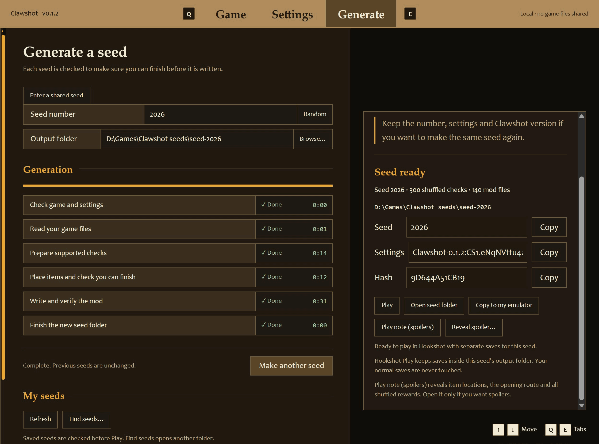
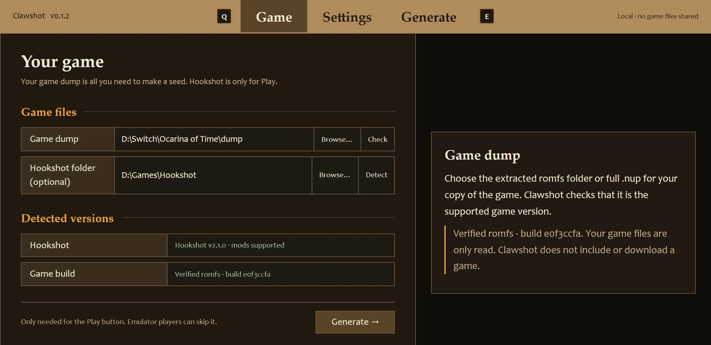
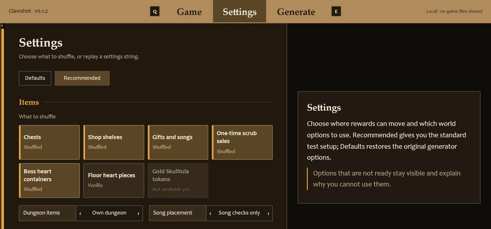
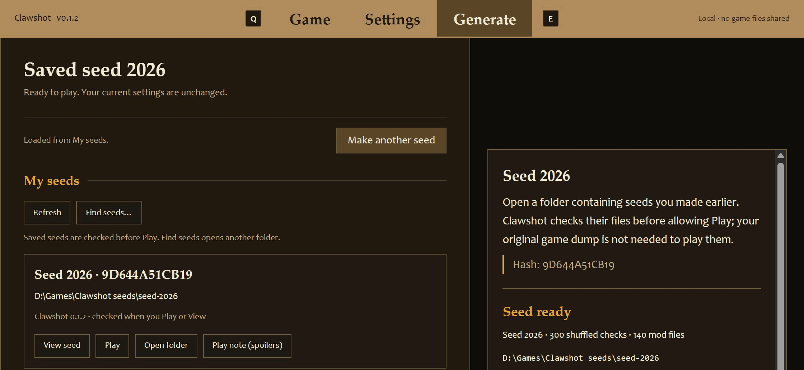

# Clawshot

[](https://discord.gg/7R5ZXPcJqn) [](https://github.com/hiKareeem/Clawshot/releases/latest)

An unofficial item randomizer for *The Legend of Zelda: Ocarina of Time* on Nintendo Switch 2,
inspired by OoT Randomizer and Ship of Harkinian's randomizer.



> [!IMPORTANT]
> Clawshot reads **your own game dump**, moves items according to access rules, and writes a
> RomFS mod: a folder of changed game files loaded instead of the originals. The supported game is
> program `0400486024DEC000`, Version 1.1.1 (update v131072), build `e0f3ccfa`.

> [!NOTE]
> This project is AI-assisted: the code is written with AI coding tools, directed, reviewed and
> play-tested by its maintainers. It contains no AI-generated art or audio.

**This is not the game.** This repository contains code, logic and location definitions, not game
files, keys or generated mods. You must generate the mod locally from your own dump. Never share
that output. Clawshot is not affiliated with or endorsed by Nintendo.

## Get started with the UI

1. Download **Clawshot-\<version\>.zip** from a [UI test release](https://github.com/hiKareeem/Clawshot/releases),
   not GitHub's generic source-code zip. Unzip the whole folder outside your game, Hookshot and Longshot folders.
2. **Windows:** double-click **Clawshot.bat**. **Linux:** run **clawshot.sh**.
   **macOS (untested):** right-click **Clawshot.command** and choose **Open** the first time
   because the download is unsigned; later, double-click it.
   The first start may download the checked app-local uv tool, Python and locked dependencies; no administrator access.
3. On **Game**, Browse to your own supported **romfs folder or .nup** and Check it.
   Hookshot or Longshot is optional: one of them is only needed for the Play button.
4. Go to **Generate**. Recommended settings, a random seed and a new Documents folder are ready;
   leave them alone for a first seed, then choose **Generate seed**. Wait for **Seed ready**.
   **Play note (spoilers)** is optional: it reveals item locations and all shuffled rewards; it does not open automatically.
5. **Hookshot or Longshot:** on Game, choose its game folder (or your Longshot Launcher folder) and press
   **Detect**, quit any running Hookshot or Longshot, then press **Play** and start a new game.
   This seed has its own playthrough. First Play copies only `option.sav` and `account.sav` from the chosen
   game's newest save-ID folder, keeping options such as Invert Jump; no progress slots are copied.
   **Emulator instead:** back up your normal saves, then **Copy to my emulator**, choose this game's
   mod folder and enable only that seed. Existing copies are never replaced.

**Longshot** is the continuation of Hookshot, where its top maintainers moved (Longshot README, introduction);
Hookshot's GitHub repository has been offline since 2026-11-13. Get Longshot's launcher from
**<https://longshot.magicbean.dev/download>** (project: <https://git.magicbean.dev/MagicBeanDev/Longshot>); it builds
the game on your PC from your own dump. Kareem verified app Play on **Longshot v3.0.0-rc.2**
on 2026-11-13: the seed loaded with isolated saves, game options carried over, shuffled rewards matched,
Xbox prompts displayed correctly, and progress survived reload. Not every runtime/item combination is played.

Keep the terminal open. **My seeds** finds your earlier seeds after a restart. Copy the number,
settings and short hash to share a seed recipe, never the generated game files. **On Discord, use
Copy for Discord** or put the settings string inside single backticks (`` `Clawshot-…` ``): Discord
otherwise reads text between two `_` as italics and drops them, and the string stops working.
[The UI guide](docs/ui.md) covers loading, saves, shared seeds and troubleshooting.
Keyboard/mouse only: **gamepad and Steam Deck controller input are not done**. The planned tracker
will be a UI tab, not a separate tool; it is not in this release.

<table>
  <tr>
    <td width="33%" valign="top"><br><sub><b>Game:</b> your dump checked as the supported build; Hookshot or Longshot is optional.</sub></td>
    <td width="33%" valign="top"><br><sub><b>Settings:</b> choose what to shuffle, or replay a settings string.</sub></td>
    <td width="33%" valign="top"><br><sub><b>My seeds:</b> earlier seeds, ready to view or play again.</sub></td>
  </tr>
</table>

## At a glance

- **Shuffled now:** chests, shop shelves, NPC gifts and songs, one-time Deku Scrub sales.
- **Optional:** boss Heart Containers, floor Heart Pieces, and small keys outside their own
  dungeon (opt-in **Small keys anywhere**; boss keys, maps and compasses never leave).
- **Not shuffled yet:** Gold Skulltula tokens, cows, dungeon rewards, pots, crates and loose rupees.

Choose the kinds you want. The UI starts with Recommended; the generator's Defaults shuffle chests
only. Some checks stay unchanged pending in-game tests; the evidence and limits are below.

## Status

**Public test builds, not a finished randomizer.** Seeds are being played and the remake's access
rules are still being checked. Every generated seed must pass the logic search before it is written;
that proves the model, not that every route has been verified in the game.

| Feature | Current evidence and limits |
|---|---|
| Chests | Changed chest rewards work in game. 165 of 184 ordinary chests are shuffled; unresolved routes and repeat rewards stay unchanged. The Goron City sign-puzzle solution is included, its failure chest is not. |
| Shops | Shuffled native shop items and purchases work in game. Arbitrary major items cannot use a stand-in shelf display. |
| NPC gifts and songs | Gift swaps and Great Fairy once-only rewards work in game, as does the Kokiri shopkeeper's extended gift window. All seven frog checks have passed their in-game experiment. Not every gift or item combination has been played. |
| One-time Business Scrubs | Four kinds of one-time Deku Scrub sale are enabled; repeat vendors stay unchanged. The implementation is tested, but the recorded results do not establish every shuffled sale in game. |
| Boss hearts and floor Heart Pieces | Optional, off by default. A Hylian Shield worked at King Dodongo and the ranch tower. Only native floor pickups are allowed; other locations and pickup combinations are not all verified. |
| Hints and convenience options | Gossip Stones speak hints without the Mask of Truth by default; this, fast start, the forest option that opens only the exit bridge (`--forest closed_deku`) and 10-rupee Kokiri prices have in-game evidence. |
| Free time travel | Experimental, off by default. Early adult return, the Prelude scene and the corrected first adult arrival have passed in-game checks. |

**Confirmed with Gift shuffle:** the first two Bombchu Bowling wins and both normal
shooting-gallery prizes give the seed's rewards (`R10-MINIGAMES-CHILD-JABU`,
`R10-MINIGAMES-ADULT`). Later wins give the game's usual rupees. The first expert gallery
wins are the only minigame checks not shuffled yet; their tests have not run.

**New with Gift shuffle:** the child Market Potion Shop bottle tutorial and Dampé's graveyard
digging prize now give shuffled rewards. Both passed their in-game checks on 2026-11-10
(`R10-MARKET-BOTTLE-FIX`, `R10-DIGGING`). The shop's corrected swap passed re-entry and shopping;
Dampé still shows a heart prize but gives the shuffled item.

First expert gallery rewards, merchant experiments and some Skulltula House rewards stay
unchanged until their tests pass; the 10-token swap alone has been observed, not every threshold.
The Door of Time's song-only and open modes each passed a first in-game check (the door and
first sword pull); returning to child afterwards is untested.

Gold Skulltula tokens, cows, dungeon completion rewards, pots, crates and loose rupees are not
shuffled. Of the dungeon items, only small keys can leave their dungeon, and only when you opt in:
**Small keys anywhere** puts them in any shuffled chest, including other dungeons and the overworld.
Boss keys, maps and compasses always stay in their own dungeon, and defaults and both presets keep
every dungeon item home. A key found outside its dungeon names that dungeon in its pickup messages
(English in every language); the game's key counters still show only the dungeon you are in. The
played gates cover key chests in and out of dungeons, correct credit, door spending and reloads,
plus presentation on a whole generated anywhere seed. Not every combination or a full
playthrough has been played.
Progressive items, entrance shuffle and Archipelago are not supported.
See [settings and restrictions](https://github.com/hiKareeem/Clawshot/blob/main/docs/settings.md) for the detailed reference.
Evidence: [recorded results](https://github.com/hiKareeem/Clawshot/blob/main/plans/00-roadmap.md)
and [playtest answers](https://github.com/hiKareeem/Clawshot/blob/main/plans/playtest/answers.md).

### Known issues

- **Saves started with older builds:** after an age-unusable item pickup, Save and Continue before using
  other items; changing areas does not clear the old item-bar jam. Newly generated seeds initialize an empty
  nut slot (0/20). Kareem verified child Bow first, then Boomerang use without a reload on 2026-11-12.
  Existing saves are not modified. `play-note.md` lists age-locked rewards but reveals item locations.
- **Trading items share one displayed slot.** An adult trade item can hide the child's Cucco; Save and Continue
  does not fix that. Wake Talon and show Zelda's Letter before taking Anju's adult Pocket Egg. Newly generated
  seeds keep trading items vanilla; older Gift seeds may contain shuffled adult trade items.
- **The Gerudo Pass stays at the captain in every newly generated seed.** Free all four carpenters and
  receive it from her; that native hand-over clears the fortress, not merely finding the card.
  Older Gift seeds could move it without clearing the guards; existing seeds and saves are not repaired.
  This follows the [static game-data trace](plans/rounds/r13-gerudo-card.md), not a played D39 acceptance test.
- Chest ocarinas show no model despite working; songs can show an ocarina stand-in rather than a
  normal item model. Only some songs have been individually played from chests.
- Previously generated seeds can lose boss keys, maps and compasses placed in small chests,
  despite showing their pickup text. Repaired map/compass saves and menus, boss-key credit,
  pickup indicator and normal boss-door opening passed in-game. Rebuilding cannot re-award opened chests.
- **Hookshot 2.0.12 and later: use Clawshot's Play or a current pack's `Play seed.bat`,** which loads the seed as a
  Hookshot mod. Packs built before 2026-11-10 used Hookshot's older overlay loading
  (`HOS_FS_OVERLAY`), which now crashes at start-up; rebuild the pack from current source.
- **Hookshot 2.1.0 text icons:** while a seed is loaded, ordinary text shows Switch buttons instead of
  your controller's. **Longshot v3.0.0-rc.2 kept Xbox button prompts** during Kareem's seed-101 app check
  on 2026-11-13. Longshot merges button-prompt sizes into the mod's size table (Longshot README, *Mods*).
  The ocarina note interface is drawn separately.
- A Market guard-house crash on Hookshot 2.0.11 matched upstream Hookshot issue #1112 (Hookshot's GitHub
  repository has been offline since 2026-11-13); no fix is claimed here.

## Play a seed pack

1. Install [uv](https://docs.astral.sh/uv/getting-started/installation/).
2. Unzip the seed pack into **its own new folder outside your game dump and your Hookshot or Longshot folders**.
   Do not extract over another pack.
3. Run **`Make seed.bat`** and give it your own supported **`.nup` file or extracted RomFS folder**.
   For Hookshot or Longshot, also give its game folder (the one containing `bin`) or your Longshot Launcher
   folder; for an emulator, leave that answer blank. Wait for **Verified seed** before playing.
4. **Hookshot or Longshot:** run **`Play seed.bat`** and start a **new game** the first time. Later plays
   continue this pack's isolated saves.
5. **Emulator, instead of Play:** **back up this game's entire emulator save folder first**.
   Copy the generated `seed/romfs` into the emulator's per-game mod folder as `<mod name>/romfs`,
   enable the mod and start a new game. For Lichii, the destination is
   `%APPDATA%\eden\load\0400486024DEC000\<mod name>\romfs`; enable it in **Properties > Add-ons**.

See the **[seed-pack guide](docs/seed-pack.md)** for detailed setup, version/digest checks, manual
Hookshot and Longshot mod folders and runtime troubleshooting. Packs contain the generator's source and
settings, not a ready-made game mod; Make builds it locally from your dump.

**Longshot without Play:** back up your saves first (the `user` folder in the game folder on Windows,
`~/.local/share/longshot` on Linux; Longshot README, *Where the files go*). Copy the made `seed/romfs` to
`<game folder>/mods/Clawshot-seed-<number>/romfs` (Longshot README, *Mods*), then start a **New Game in an empty
slot**. The mod applies to every save slot: remove that folder before playing your normal saves.

Hookshot, Longshot app Play and Lichii have recorded loading/play results. Other emulator/console
layouts remain unverified in game. Use the current mod-loading instructions, not an older overlay launcher.
Keep packs in separate new folders and preserve your saves. Emulator New Game replaces this game's
save progress: back up the entire save folder first. The pack's isolated saves do not isolate
emulator saves, and manually installing a Hookshot or Longshot mod uses that game's normal saves.

Questions, test packs and reports: **[Clawshot Discord](https://discord.gg/7R5ZXPcJqn)**. Paste settings strings
there inside single backticks (or with the UI's **Copy for Discord**). Never post a dump, generated mod, cache or save.

## Run from source

Use Python 3.12+ and uv. From a checkout, generate into a **new folder outside the repository and
game dump**; never overwrite a seed that might be in use:

```sh
uv sync --frozen
uv run python -m clawshot --help
uv run python -m clawshot --romfs C:/Games/OoT/romfs --seed 7 --out C:/Clawshot/seed-7
```

`--romfs` takes an extracted RomFS folder with the supported update applied, a `.nup`, or a dump
folder that keeps the base game and its updates apart (`base/romfs` and `updates/<version>/romfs`,
the layout NUP packs from; an update may hold only its changed files). From a dump folder the newest
update is laid over the base, so it must be the supported one: today that is v131072 (Version 1.1.1). A later
game update is a different build, and Clawshot refuses it until it supports that build. For a `.nup`
or a dump folder the generator first copies the files it reads to a temporary folder. The base game's
RomFS alone (Version 1.0.0) is refused; the UI accepts `base/romfs` picked inside a dump folder and uses the dump folder.
A default seed shuffles chests. To print settings without opening the dump, then replay them:

```sh
uv run python -m clawshot --shuffle Chest Shop Gift --print-settings
uv run python -m clawshot --romfs C:/Games/OoT/romfs --seed 7 --settings CS1 --out C:/Clawshot/seed-7-defaults
```

`CS1` alone means defaults; replace it with the **complete string printed by the first command**
to replay that command's choices. Explicit options override the string. Reproduction needs the
same seed, settings, generator source and world data, not just the same version label.

The output has `romfs/`, `play-note.md` (directions, warnings and item-location spoilers) and `spoiler.json` (all placements).
Load it using the [seed-pack guide's runtime instructions](docs/seed-pack.md); generation does not
start the game. More options: [settings](https://github.com/hiKareeem/Clawshot/blob/main/docs/settings.md).
For logic ports and trackers: [logic reference](https://github.com/hiKareeem/Clawshot/blob/main/docs/logic.md).

## Development and contributions

Kareem directs AI coding agents that implement Clawshot. Automated tests check formats, logic and
output; Kareem performs the in-game checks. A behavior change is not called working in game until
he has observed it; built and untested work is labelled above. Contributions from people are welcome.
Kareem and his co-owner decide scope and merge changes.

Read [CONTRIBUTING.md](https://github.com/hiKareeem/Clawshot/blob/main/CONTRIBUTING.md)
for licensing, source restrictions, checks and evidence to
include. Start with a small, single-topic change, or discuss it on Discord. Do not submit game files
or anything generated from them, including in issues and attachments.

## Credits and licence

Clawshot is [MIT licensed](LICENSE). [NOTICE](NOTICE) lists the pinned sources and licences:
OoT Randomizer's world, rule language, search and fill; Archipelago's safe fill swap; and a55uka's
NUP reader. Their work is credited without implying endorsement. Nintendo owns the game and its
trademarks; no part of it is included here.
